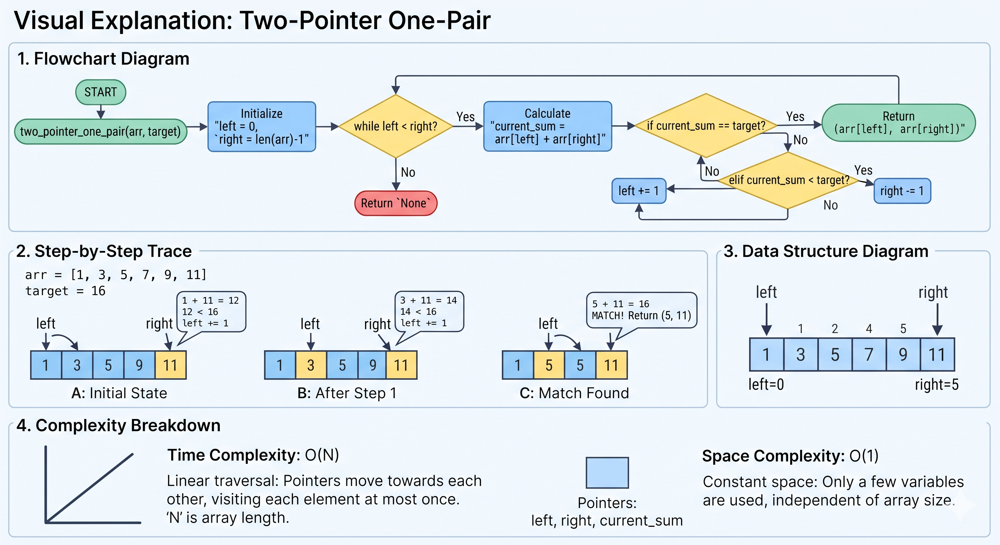
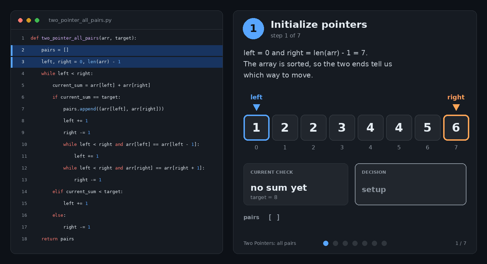
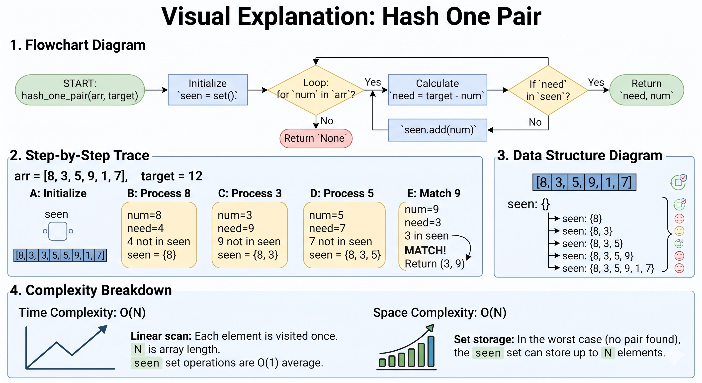
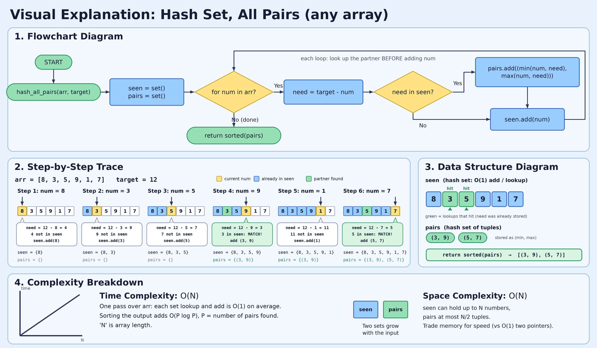

# Pair Sum: Two Pointers and Hashing

*One pair and all pairs, with every step shown as comments*

## Which method to use

| Situation | Method | Time | Space |
|---|---|---|---|
| Sorted array | Two pointers | O(n) | O(1) |
| Unsorted array | Hash set / hash map | O(n) | O(n) |
| Unsorted, O(1) space required | Sort, then two pointers | O(n log n) | O(1) if sorted in place |
| Unsorted, original indices needed | Hash map (value to index) | O(n) | O(n) |

Rule of thumb: **sorted means two pointers, unsorted means hash.**

## Part 1: Two pointers, one pair (sorted array)

Put `left` on the smallest value and `right` on the largest. If the sum is too small, move `left` right. If it is too big, move `right` left. If it matches, return the pair.

```python
def two_pointer_one_pair(arr, target):
    left, right = 0, len(arr) - 1      # left = 0, right = 5
    while left < right:
        current_sum = arr[left] + arr[right]
        if current_sum == target:
            return arr[left], arr[right]
        elif current_sum < target:
            left += 1
        else:
            right -= 1
    return None

print(two_pointer_one_pair([1, 3, 5, 7, 9, 11], 16))   # (5, 11)
```

Values for `arr = [1, 3, 5, 7, 9, 11]`, `target = 16`:

```python
# Round 1: left = 0, right = 5
#   current_sum = arr[0] + arr[5] = 1 + 11 = 12
#   12 == 16 ? no
#   12 < 16  ? yes, too small -> left += 1 -> left = 1

# Round 2: left = 1, right = 5
#   current_sum = arr[1] + arr[5] = 3 + 11 = 14
#   14 < 16  ? yes, too small -> left = 2

# Round 3: left = 2, right = 5
#   current_sum = arr[2] + arr[5] = 5 + 11 = 16
#   16 == 16 ? yes -> return (5, 11)
```

| Round | left | right | arr[left] + arr[right] | vs 16 | Action |
|---|---|---|---|---|---|
| 1 | 0 | 5 | 1 + 11 = 12 | too small | `left += 1` |
| 2 | 1 | 5 | 3 + 11 = 14 | too small | `left += 1` |
| 3 | 2 | 5 | 5 + 11 = 16 | **equal** | return `(5, 11)` |




## Part 2: Two pointers, all pairs (sorted array)

Same idea, but on a match you record the pair, move **both** pointers, and skip repeated values so the same pair is not recorded twice.

```python
def two_pointer_all_pairs(arr, target):
    pairs = []
    left, right = 0, len(arr) - 1       # left = 0, right = 7
    while left < right:
        current_sum = arr[left] + arr[right]
        if current_sum == target:
            pairs.append((arr[left], arr[right]))
            left += 1
            right -= 1
            while left < right and arr[left] == arr[left - 1]:      # skip repeated left values
                left += 1
            while left < right and arr[right] == arr[right + 1]:    # skip repeated right values
                right -= 1
        elif current_sum < target:
            left += 1
        else:
            right -= 1
    return pairs

print(two_pointer_all_pairs([1, 2, 2, 3, 4, 4, 5, 6], 8))   # [(2, 6), (3, 5), (4, 4)]
```

Values for `arr = [1, 2, 2, 3, 4, 4, 5, 6]`, `target = 8`:

```python
# index: 0  1  2  3  4  5  6  7
# value: 1  2  2  3  4  4  5  6

# Round 1: left = 0, right = 7
#   1 + 6 = 7  -> 7 < 8, too small -> left = 1

# Round 2: left = 1, right = 7
#   2 + 6 = 8  -> match, pairs = [(2, 6)]
#   left = 2, right = 6
#   skip left:  arr[2] == arr[1] ? 2 == 2 -> yes -> left = 3
#               arr[3] == arr[2] ? 3 == 2 -> no, stop
#   skip right: arr[6] == arr[7] ? 5 == 6 -> no

# Round 3: left = 3, right = 6
#   3 + 5 = 8  -> match, pairs = [(2, 6), (3, 5)]
#   left = 4, right = 5
#   skip left:  arr[4] == arr[3] ? 4 == 3 -> no
#   skip right: arr[5] == arr[6] ? 4 == 5 -> no

# Round 4: left = 4, right = 5
#   4 + 4 = 8  -> match, pairs = [(2, 6), (3, 5), (4, 4)]
#   left = 5, right = 4 -> left < right is False, loop ends

# return [(2, 6), (3, 5), (4, 4)]
```

Without the skip loops, the second `2` in round 2 would be tried against the right side again. The skip loops say: "if my new pointer is on the same value I just used, move on."



## Part 3: Hash set, one pair (any array)

Keep a "notebook" (a set) of numbers seen earlier. For each number, work out the partner you need (`target - num`) and check whether it is already in the notebook. Check **before** adding, so a number is never paired with itself.

```python
def hash_one_pair(arr, target):
    seen = set()                        # seen = {}
    for num in arr:
        need = target - num
        if need in seen:
            return need, num
        seen.add(num)
    return None

print(hash_one_pair([8, 3, 5, 9, 1, 7], 12))   # (3, 9)
```

Values for `arr = [8, 3, 5, 9, 1, 7]`, `target = 12`:

```python
# seen = {}

# num = 8
#   need = 12 - 8 = 4
#   is 4 in {} ?             no
#   seen.add(8) -> seen = {8}

# num = 3
#   need = 12 - 3 = 9
#   is 9 in {8} ?            no
#   seen.add(3) -> seen = {8, 3}

# num = 5
#   need = 12 - 5 = 7
#   is 7 in {8, 3} ?         no
#   seen.add(5) -> seen = {8, 3, 5}

# num = 9
#   need = 12 - 9 = 3
#   is 3 in {8, 3, 5} ?      YES
#   return (3, 9)            # 3 + 9 = 12
```

| num | need = 12 - num | need in seen? | seen after |
|---|---|---|---|
| 8 | 4 | no | `{8}` |
| 3 | 9 | no | `{8, 3}` |
| 5 | 7 | no | `{8, 3, 5}` |
| 9 | 3 | **yes** | return `(3, 9)` |




## Part 4: Hash set, all pairs (any array)

Do not return on a match. Save the pair in a second set instead. Store each pair as `(smaller, larger)` so `(3, 9)` and `(9, 3)` count as the same pair, and the set removes repeats automatically.

```python
def hash_all_pairs(arr, target):
    seen = set()                        # seen = {}
    pairs = set()                       # pairs = {}
    for num in arr:
        need = target - num
        if need in seen:
            pairs.add((min(num, need), max(num, need)))
        seen.add(num)
    return sorted(pairs)

print(hash_all_pairs([8, 3, 5, 9, 1, 7], 12))   # [(3, 9), (5, 7)]
```

Values for `arr = [8, 3, 5, 9, 1, 7]`, `target = 12`:

```python
# seen = {}, pairs = {}

# num = 8:  need = 4,  4 in {} ?              no   -> seen = {8}
# num = 3:  need = 9,  9 in {8} ?             no   -> seen = {8, 3}
# num = 5:  need = 7,  7 in {8, 3} ?          no   -> seen = {8, 3, 5}
# num = 9:  need = 3,  3 in {8, 3, 5} ?       YES  -> pairs = {(3, 9)}
#                                                     seen = {8, 3, 5, 9}
# num = 1:  need = 11, 11 in {8, 3, 5, 9} ?   no   -> seen = {8, 3, 5, 9, 1}
# num = 7:  need = 5,  5 in {8, 3, 5, 9, 1} ? YES  -> pairs = {(3, 9), (5, 7)}
#                                                     seen = {8, 3, 5, 9, 1, 7}

# return sorted(pairs) = [(3, 9), (5, 7)]
```

| num | need = 12 - num | need in seen? | pairs after |
|---|---|---|---|
| 8 | 4 | no | `{}` |
| 3 | 9 | no | `{}` |
| 5 | 7 | no | `{}` |
| 9 | 3 | **yes** | `{(3, 9)}` |
| 1 | 11 | no | `{(3, 9)}` |
| 7 | 5 | **yes** | `{(3, 9), (5, 7)}` |



## Part 5: Hash map, indices (LeetCode 1)

When the problem wants **positions** and not values, store `value -> index` in a dictionary.

```python
def two_sum_indices(nums, target):
    seen = {}                           # value -> index
    for i, num in enumerate(nums):
        need = target - num
        if need in seen:
            return [seen[need], i]
        seen[num] = i
    return None

print(two_sum_indices([3, 2, 4], 6))   # [1, 2]
```

Values for `nums = [3, 2, 4]`, `target = 6`:

```python
# seen = {}

# i = 0, num = 3
#   need = 6 - 3 = 3
#   is 3 in {} ?                 no (3 is not paired with itself)
#   seen[3] = 0 -> seen = {3: 0}

# i = 1, num = 2
#   need = 6 - 2 = 4
#   is 4 in {3: 0} ?             no
#   seen[2] = 1 -> seen = {3: 0, 2: 1}

# i = 2, num = 4
#   need = 6 - 4 = 2
#   is 2 in {3: 0, 2: 1} ?       YES, at index 1
#   return [1, 2]                # nums[1] + nums[2] = 2 + 4 = 6
```

## Things to remember

- Two pointers needs a **sorted** array. On unsorted input the "move left or right" logic breaks.
- Use `while left < right`, not `<=`, so a number is never paired with itself.
- In the hash methods, check `need in seen` **before** `seen.add(num)`.
- Hash trades **memory for speed**. Two pointers gets the same speed with no extra memory, but only because sorted order does the work.
- Interview answer: "Brute force is O(n^2). If sorted, I use two pointers for O(n) time and O(1) space. If unsorted, I use a hash set for O(n) time and O(n) space."
