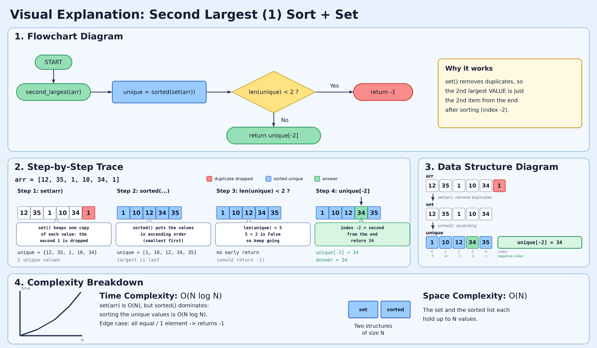
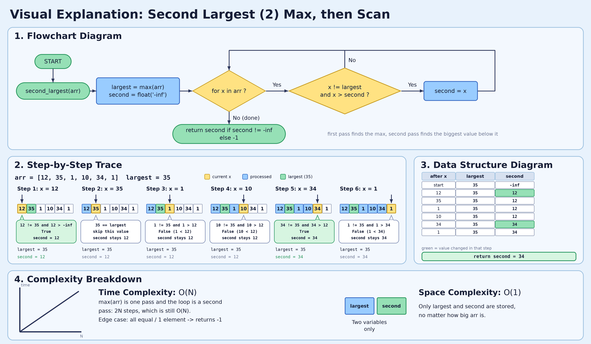
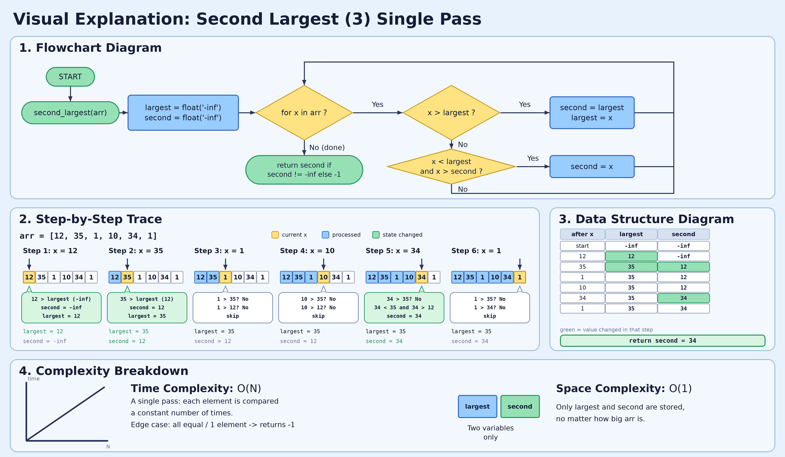

# Second Largest Element in an Array

*Three approaches, with values as comments*

## The problem

Given an array, find the **second largest distinct value**. Return `-1` if there is none, for example when all elements are equal or the array has one element.

`arr = [12, 35, 1, 10, 34, 1]` gives `34`.

"Distinct" matters. In `[10, 5, 10]` the answer is `5`, not `10`, because the second `10` is the same value as the largest.

## Approach 1: Sort (simple, O(n log n))

```python
def second_largest(arr):
    unique = sorted(set(arr))           # [12, 35, 1, 10, 34, 1] -> [1, 10, 12, 34, 35]
    if len(unique) < 2:
        return -1
    return unique[-2]                   # second from the end -> 34

print(second_largest([12, 35, 1, 10, 34, 1]))   # 34
```

`set` removes duplicates first. It works, but sorting everything just to find one value is more work than needed.



## Approach 2: Two passes (O(n))

1. First pass: find the largest.
2. Second pass: find the biggest value that is **not** the largest.

```python
def second_largest(arr):
    largest = max(arr)                              # largest = 35
    second = float('-inf')
    for x in arr:
        if x != largest and x > second:
            second = x
    return second if second != float('-inf') else -1
```

```python
# arr = [12, 35, 1, 10, 34, 1], largest = 35, second = -inf
# x = 12: 12 != 35 and 12 > -inf -> second = 12
# x = 35: 35 != 35 ? no -> skip
# x = 1:  1 != 35 and 1 > 12 ? no -> skip
# x = 10: 10 > 12 ? no -> skip
# x = 34: 34 != 35 and 34 > 12 -> second = 34
# x = 1:  1 > 34 ? no -> skip
# return 34
```



## Approach 3: Single pass (the interview answer, O(n) time, O(1) space)

Track both `largest` and `second` as you scan once. For each number `x`:

- **`x > largest`:** `x` is the new largest, and the old largest becomes `second`.
- **`x < largest` and `x > second`:** `x` fits between them, so it becomes `second`.
- **`x == largest`:** ignore it (this is what handles duplicates).

```python
def second_largest(arr):
    largest = float('-inf')                 # largest = -inf
    second = float('-inf')                  # second = -inf

    for x in arr:
        if x > largest:
            second = largest                # old largest slides down
            largest = x
        elif x < largest and x > second:
            second = x

    return second if second != float('-inf') else -1

print(second_largest([12, 35, 1, 10, 34, 1]))   # 34
```

### Values as comments

`arr = [12, 35, 1, 10, 34, 1]`

```python
largest = -inf, second = -inf

# x = 12: 12 > -inf ? yes -> second = -inf, largest = 12
# x = 35: 35 > 12 ?   yes -> second = 12,   largest = 35
# x = 1:  1 > 35 ? no.  1 < 35 and 1 > 12 ? no -> no change
# x = 10: 10 > 35 ? no. 10 < 35 and 10 > 12 ? no -> no change
# x = 34: 34 > 35 ? no. 34 < 35 and 34 > 12 ? yes -> second = 34
# x = 1:  1 > 35 ? no.  1 < 35 and 1 > 34 ? no -> no change

# return 34
```

| x | Case | largest | second |
|---|---|---|---|
| (start) | | -inf | -inf |
| 12 | new largest | 12 | -inf |
| 35 | new largest | 35 | 12 |
| 1 | too small | 35 | 12 |
| 10 | too small | 35 | 12 |
| 34 | fits between | 35 | **34** |
| 1 | too small | 35 | 34 |

### Picture of the two trackers

```
x = 12    largest [ 12 ]   second [ -inf ]
x = 35    largest [ 35 ]   second [ 12 ]     <- 12 slid down
x = 1     largest [ 35 ]   second [ 12 ]     (too small)
x = 10    largest [ 35 ]   second [ 12 ]     (too small)
x = 34    largest [ 35 ]   second [ 34 ]     <- 34 fits between 12 and 35
x = 1     largest [ 35 ]   second [ 34 ]     (too small)
```



### Duplicates: `[10, 5, 10]`

```python
# x = 10: 10 > -inf -> second = -inf, largest = 10
# x = 5:  5 < 10 and 5 > -inf -> second = 5
# x = 10: 10 > 10 ? no.  10 < 10 ? no -> ignored
# return 5
```

The `x < largest` check is what stops the second `10` from becoming `second`.

### All equal: `[10, 10, 10]`

```python
# x = 10: 10 > -inf -> second = -inf, largest = 10
# x = 10: 10 > 10 ? no.  10 < 10 ? no -> ignored
# x = 10: same -> ignored
# second is still -inf -> return -1
```

## Why `-inf` and not `-1` as the starting value

Starting with `-1` breaks on negative numbers. For `[-5, -2, -9]` the code would never replace `-1`, because `-5 > -1` is false. It would return `-1` when the real answer is `-5`. `float('-inf')` is smaller than any number, so it always gets replaced.

```python
# arr = [-5, -2, -9]
# x = -5: -5 > -inf -> second = -inf, largest = -5
# x = -2: -2 > -5   -> second = -5,   largest = -2
# x = -9: -9 > -2 ? no. -9 < -2 and -9 > -5 ? no -> no change
# return -5
```

## Edge cases

| arr | Answer |
|---|---|
| `[12, 35, 1, 10, 34, 1]` | 34 |
| `[10, 5, 10]` | 5 |
| `[10, 10, 10]` | -1 (no second distinct value) |
| `[5]` | -1 |
| `[1, 2]` and `[2, 1]` | 1 |
| `[-5, -2, -9]` | -5 |

## Complexity

| Approach | Time | Space |
|---|---|---|
| Sort | O(n log n) | O(n) with `set` |
| Two passes | O(n) | O(1) |
| Single pass | **O(n)** | **O(1)** |

## What to say in an interview

> "Sorting is O(n log n), which is more than needed. I'll scan once and keep the largest and second largest. A bigger number pushes the old largest down to second, a number between the two replaces second, and equal values are ignored so duplicates don't count. That is O(n) time and O(1) space."

## Practice

Find the second largest by hand, then check with the code:

```python
arr = [4, 9, 2, 9, 7]
arr = [-3, -1, -7, -1]
arr = [8, 8, 8, 3]
arr = [6]
```
